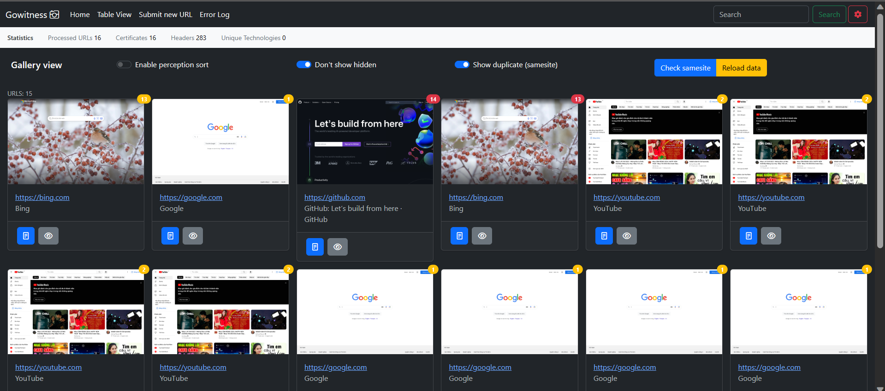

<h1 align="center">
  <br>
    🔍 gowitness v2
  <br>
  <br>
</h1>

<h4 align="center">A golang, web screenshot utility using Chrome Headless.</h4>
<p align="center">
  <a href="https://twitter.com/leonjza"></a>
  <a href="https://goreportcard.com/report/github.com/sensepost/gowitness"></a>
  <a href="https://github.com/sensepost/gowitness/actions/workflows/docker.yml"></a>
</p>
<br>


## screenshots



## credits

`gowitness` would not have been posssible without some of these amazing projects: [chromedp](https://github.com/chromedp/chromedp), [tabler](https://github.com/tabler/tabler), [zerolog](https://github.com/rs/zerolog), [cobra](https://github.com/spf13/cobra), [gorm](https://github.com/go-gorm/gorm), [go-nmap](https://github.com/lair-framework/go-nmap), [wappalyzergo](https://github.com/projectdiscovery/wappalyzergo), [goimagehash](https://github.com/corona10/goimagehash)

## license

`gowitness` is licensed under a [GNU General Public v3 License](https://www.gnu.org/licenses/gpl-3.0.en.html). Permissions beyond the scope of this license may be available at <http://sensepost.com/contact/>.

## building

`web/dist` is generated and not kept in git, but the go binary embeds it, so the
frontend has to be built before the backend:

```
cd web && npm ci && npm run build && cd ..
go build -o gowitness .
```

Requires go >= 1.26 (a chromedp/cdproto requirement) and a current Node LTS.

## New Feature  

- [X] Added queue for screenshot feature (concurrency defaults to 5, set it with `--max-jobs`).  
[https://github.com/X-Cotang/gowitness-wrap/blob/51092960f4eccb33d937f0bdec99119057f9ca53/cmd/server.go#L22](https://github.com/X-Cotang/gowitness-wrap/blob/51092960f4eccb33d937f0bdec99119057f9ca53/cmd/server.go#L22)  

```
curl -X POST http://localhost:7171/api/screenshot/v2 --data '{"url": "https://google.com"}'
```  

- [X] New Tab: Error Log  
- [X] Array input  

```
curl -X POST http://localhost:7171/api/screenshot/v2 --data '{"urls": ["https://google.com","https://youtube.com"]}'
```  

- [X] Docker: Nginx + Self-Signed SSL Certificate + htpasswd

```
htpasswd nginx/.htpasswd admin
sudo openssl req -x509 -nodes -days 365 -newkey rsa:2048 -keyout nginx/ssl/nginx-selfsigned.key -out nginx/ssl/nginx-selfsigned.crt
sudo openssl dhparam -out nginx/ssl/dhparam.pem 2048
docker-compose up
```  

- [X] Group the same websites by perceptual hashing and nilsimsa hashing.
- [X] Callback function for other tools
- [ ] Truncate old data